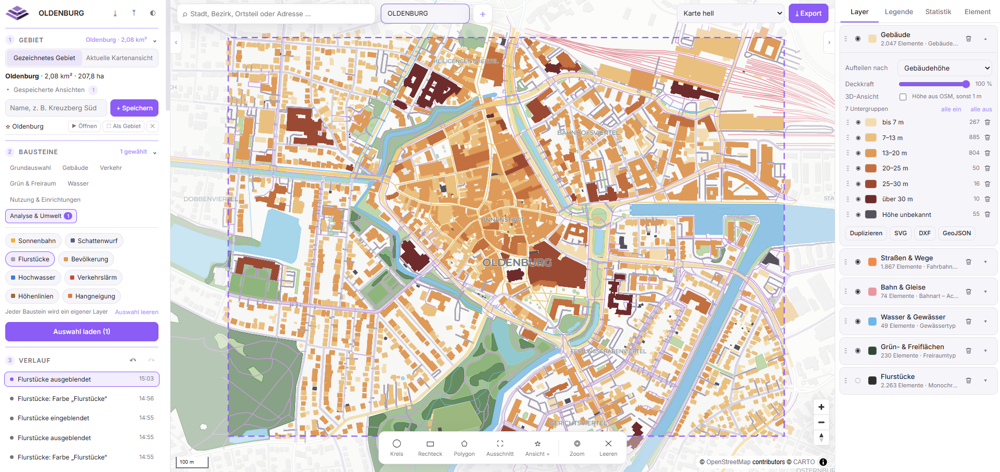
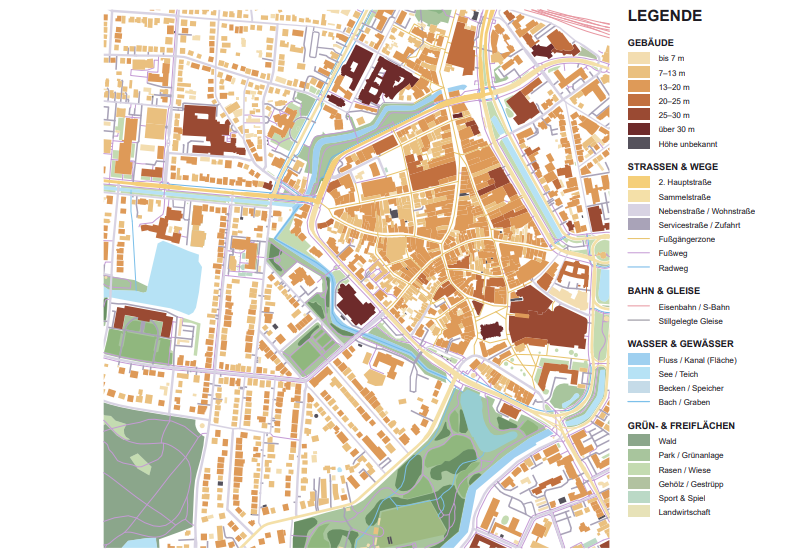

# QUAVA – Site Analyst

**QUAVA macht aus einem frei gewählten Stadtausschnitt in Deutschland in wenigen Minuten fertige städtebauliche Analysepläne, die man in Illustrator oder CAD weiterbearbeiten kann.**

👉 **Live-Demo:** https://jade-hs-vibecoding-wpk.github.io/urban-analyst/

Uni-Projekt von Kevin Wasenmüller · WPK Vibecoding KI-Werkstatt · Jade Hochschule, Fachbereich Architektur · Blockwoche 16.–20.11.2026

## Wofür?

Für Architektur- und Städtebaustudierende bei der **Bestandsanalyse**: Schwarzplan, Nutzung, Erschließung, Freiraum.
Bisher heißt das: Daten in QGIS mit QuickOSM laden, sortieren, umfärben und alles in Illustrator nachzeichnen. Das kostet Stunden.
QUAVA lädt die Daten direkt im Browser, sortiert sie in thematische **Bausteine** und exportiert einen maßstäblichen Plan mit Ebenen.

## So geht's

1. **Gebiet wählen:** Ort suchen (Stadt, Bezirk, Adresse) oder auf der Karte ein Rechteck, Polygon oder einen Kreis zeichnen.
2. **Bausteine laden:** zum Beispiel Gebäude, Straßen & Wege, Grün, Wasser, Bahn, ÖPNV, Bäume, Flächennutzung. Pro Baustein wählst du eine **Aufteilung** (z. B. Gebäude nach Höhe oder Nutzung) und passt die **Farben** an.
3. **Ansehen und prüfen:** Legende, Statistik (z. B. Überbauungsgrad, Grünanteil) und Infos per Klick auf jedes Element.
4. **Exportieren:** als SVG, PDF, DXF, GeoJSON oder PNG.

## Exporte

| Format | Wofür | Was drin ist |
|---|---|---|
| **SVG** | Illustrator | ein Pfad pro Objekt, am Gebiet zugeschnitten, im Maßstab; mit dem Skript `QUAVA_Ebenen.jsx` (Download im Export-Fenster) werden daraus echte Ebenen |
| **PDF** | Drucken, Illustrator | A4/A3 hoch oder quer oder Plangröße, Vorschau mit verschiebbarem Ausschnitt, freier Maßstab, Schriftfeld mit Überschrift, Beschreibung, Maßstab und Nordpfeil |
| **DXF** | CAD (getestet in Allplan) | DXF R12 in Metern, eine Ebene pro Untergruppe, Fahrbahnen in echter Breite; Flächen als Umrisse |
| **GeoJSON** | QGIS | ZIP mit einer Datei pro Layer |
| **PNG** | schnell zeigen | Bild der Karte |

Projekte lassen sich als Datei speichern und wieder öffnen (`.quava.json`). Mehrere Projekte laufen nebeneinander in Tabs.

## Installation und Start

Es ist **nichts zu installieren**, und du brauchst **keine Anmeldung und keinen API-Key**.

- **Online:** den Link oben öffnen (Chrome oder Edge).
- **Offline-Datei:** `index.html` herunterladen und per Doppelklick im Browser öffnen. Für die Karte und die Daten braucht der Browser trotzdem Internet.
- Tipp: Gebiete am Anfang klein halten (unter ca. 5 km²), dann geht das Laden schneller.

## Ehrlich mit Daten

Fehlt in OpenStreetMap eine Angabe (z. B. die Gebäudehöhe), steht **„unbekannt“** da. Geschätzte Werte (z. B. Höhe = Geschosse × 3 m) sind als **„geschätzt“** gekennzeichnet. Amtliche Höhen (Berlin, Niedersachsen) sind als „amtlich“ markiert.

## Quellen und Lizenzen

**Daten**
- © OpenStreetMap-Mitwirkende, [ODbL](https://opendatacommons.org/licenses/odbl/), über die Overpass-API (overpass-api.de, Ersatzserver) und Nominatim (Ortssuche)
- Berlin: Geoportal Berlin / Umweltatlas (Gebäudehöhen, Einwohnerdichte, Baumbestand, ALKIS-Flurstücke), Datenlizenz Deutschland
- Niedersachsen: © LGLN OpenGeoData (3D-Gebäudemodell LoD2, ALKIS-Flurstücke, DGM1), [CC BY 4.0](https://creativecommons.org/licenses/by/4.0/)
- Zensus 2022, © Statistische Ämter des Bundes und der Länder, [dl-de/by-2-0](https://www.govdata.de/dl-de/by-2-0) (über den Zensusatlas-Dienst NRW)
- Hochwassergefahrenkarten der Länder, bereitgestellt von der Bundesanstalt für Gewässerkunde (BfG)
- Lärmkartierung 2022, © Umweltbundesamt

**Karte und Bibliotheken**
- Hintergrundkarten © CARTO (Dark Matter, Positron, Voyager), Kartendaten © OpenStreetMap-Mitwirkende
- [MapLibre GL JS](https://maplibre.org/) 4.7.1 (BSD-3-Clause), [Turf.js](https://turfjs.org/) 7.1.0 (MIT), [JSZip](https://stuk.github.io/jszip/) 3.10.1 (MIT)
- Schrift Inter (SIL Open Font License), Farbpaletten teilweise nach ColorBrewer (Cynthia Brewer, colorbrewer2.org)

**Bilder**
- Screenshots und Plan: aus QUAVA erstellt. Logo: eigene Gestaltung.

## KI-Nutzung

Dieses Projekt ist im Kurs „Vibecoding“ entstanden: **Der Code wurde mit KI geschrieben.**
- **Werkzeug:** Claude (Anthropic), unter anderem das Modell Claude Opus 5.5
- **Wofür:** Programmierung der App (HTML, CSS, JavaScript), Suche nach Datenquellen, Fehlersuche, Tests sowie Texte für README und Poster
- **Wann:** 16.–19.11.2026
- **Meine Rolle:** Idee, Anforderungen, Gestaltung (Farben, Ebenen, Planlayout), Testen jedes Schritts mit echten Daten in Illustrator und CAD, Entscheidungen, was bleibt und was gestrichen wird. Jeder getestete Schritt steht in `PLAN.md`.

## Ordner

- `index.html` – die ganze App (eine Datei: HTML, CSS, JavaScript)
- `README.md` – diese Beschreibung
- `PLAN.md` – Plan, Stand und alle getesteten Schritte
- `CLAUDE.md` – Regeln und Technik für die KI
- `docs/screenshots/` – Bilder für diese README
- `versionen/` – Sicherungen aller Zwischenstände
- `LICENSE` – Apache License 2.0
